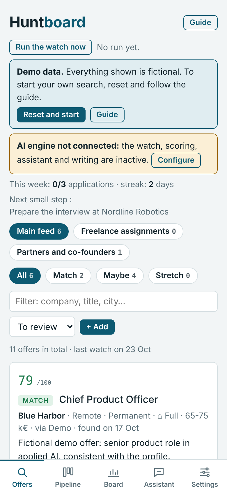
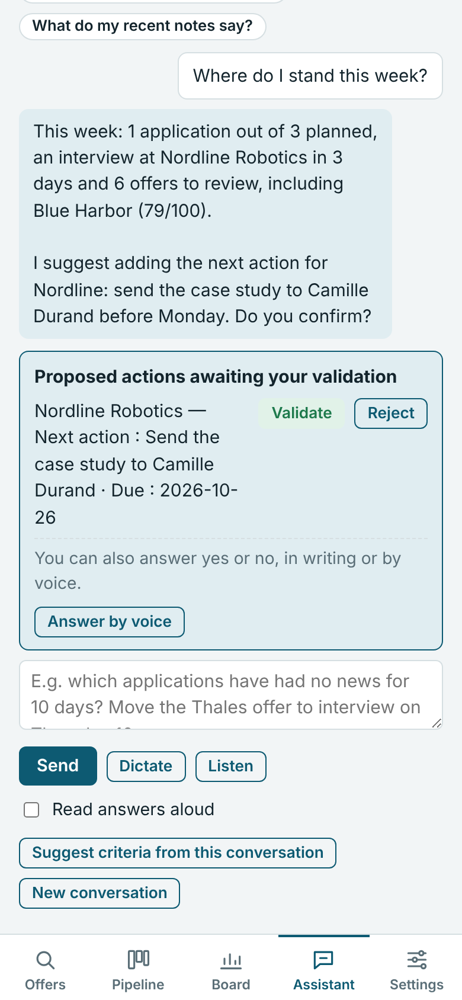
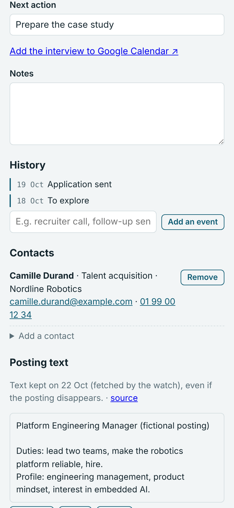
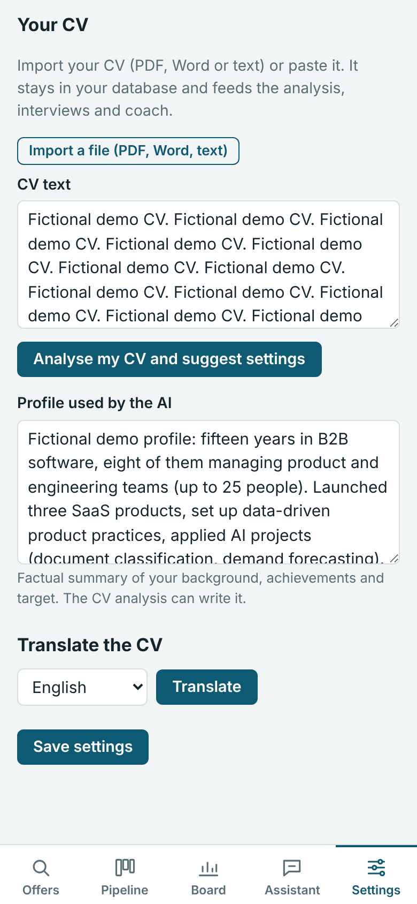
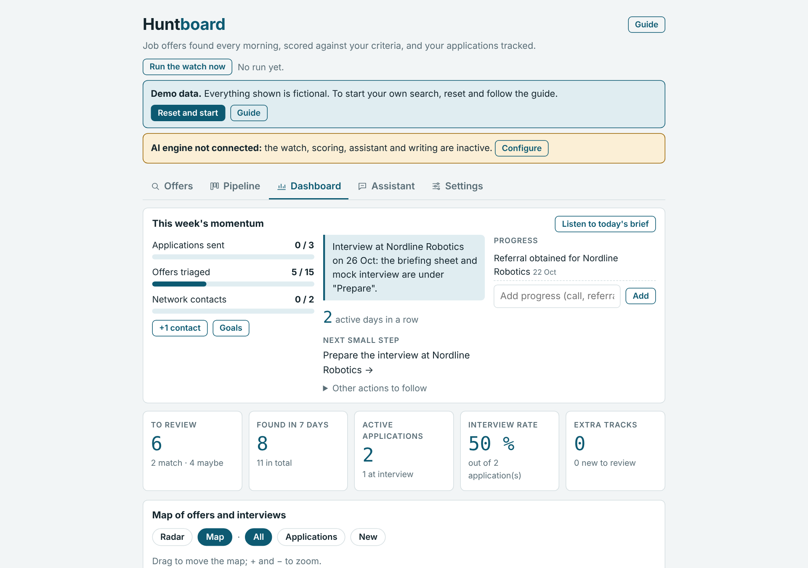

# Huntboard

**Your job hunt on one board.** Offers found every morning and scored against your own rules,
an application pipeline, contacts and kept posting texts, a map, an AI assistant that reads your
data and proposes actions you validate, CV import and translation, cover letters and interview
preparation. Bilingual interface (French / English), usable on a phone.

**English** · [Français](README.fr.md)

<p align="center">
  
  
  
  
</p>
<p align="center"></p>

> Screenshots use entirely fictional demo data (`scripts/demo_data.py`).

## ⚠️ Prerequisite: an AI connection

Huntboard is built around a language model. **Without one, most of the app loses its point**:
no daily watch, no scoring, no assistant, no CV analysis, no letters or interview preparation —
only manual tracking remains.

| Distribution | What you need |
|---|---|
| **Claude kit** | A Claude account whose plan allows artifacts and scheduled tasks. The page uses your Claude usage (you are asked once to allow it). A mail connector (Gmail) is optional but recommended for e-mail alerts. |
| **Self-hosted app** | An API key: **Anthropic** (recommended), or any OpenAI-compatible API (OpenAI, Gemini, Grok, Mistral, DeepSeek, OpenRouter) or a local model (Ollama, LM Studio). Web search comes from the provider when it has one (Claude, OpenAI, Gemini, Grok, OpenRouter) or from Brave, Tavily or a self-hosted SearXNG — so a fully local setup works too. See [AI engines and web search](docs/en/ai-engines.md). Set a spending cap with your provider. |

## What it does

- **Daily watch** — collects offers from job boards, company pages and your e-mail alerts
  (LinkedIn, Indeed, HelloWork… LinkedIn is never scraped, see [limits](docs/en/limitations.md)),
  scores each out of 100 against your rules (commute and remote days, salary floor, roles,
  fields) with a visible breakdown. Each morning: a notification with the news, or a short,
  factual encouragement when nothing is new.
- **Triage that learns** — *Interested* / *Discard* with a one-tap reason; learned trends are
  shown and revocable.
- **Separate tracks** — freelance assignments, international roles, co-founder searches… each
  with its own criteria, sources and cadence, kept out of the main feed unless you decide
  otherwise.
- **Pipeline** — kanban with an offer page: dates, next action, notes, history, **contacts**
  (e-mail, phone), and the **full posting text kept** as soon as the offer is worth exploring.
  Application acknowledgements (job boards, Workday, SmartRecruiters…) are recorded
  automatically.
- **Assistant** — ask anything about your offers, applications, contacts, notes or settings; it
  looks your data up and **proposes changes that you validate** with a tap or by answering
  yes / no, in writing or by voice.
- **Notes** — free notes, typed or dictated, searchable and available to the assistant.
- **Dashboard** — weekly momentum (goals, streak, next small step, progress log), key figures,
  **map** (vector map or radar around home), statistics.
- **Documents and letters** — keep original CVs and translations; cover-letter generator with a
  searchable offer picker, inspired by your saved letters.
- **Interviews** — brief, mock interview with scored feedback, debrief; read aloud.
- **Assisted setup** — onboarding, CV analysis into criteria, settings completeness gauge with
  an AI review, recommended sources for ten countries, **AI source suggestions** tailored to your
  profile and to each source's yield, checked on the web (a weekly suggestion comes with the
  Monday watch).

## Two ways to run it

| | **Claude kit** (`kit/`) | **Self-hosted app** (`app/`) |
|---|---|---|
| Runs | In your Claude account (artifact + scheduled task) | On your server (Docker) |
| Install | Import the skill, then ask Claude "Set up my Huntboard" | `docker compose up -d` |
| AI | Your Claude plan | Your API key (pay as you go) or a local model |

Both share **the same page** (`kit/skills/huntboard/template/huntboard.html`).

## Quick start — self-hosted

With the published image (no clone, no build):

```bash
mkdir huntboard && cd huntboard
curl -fsSLO https://raw.githubusercontent.com/tamaris-labs/huntboard/main/deploy/docker-compose.yml
curl -fsSL -o .env https://raw.githubusercontent.com/tamaris-labs/huntboard/main/.env.example   # then set at least LLM_API_KEY and APP_PASSWORD
docker compose up -d
```

Or from source: `git clone https://github.com/tamaris-labs/huntboard.git && cd huntboard`,
`cp .env.example .env`, then `docker compose up -d --build`.

Open `http://localhost:8000`; the setup assistant starts. Image: `ghcr.io/tamaris-labs/huntboard`
(`latest`, or a version number). Details: [docs/en/deployment.md](docs/en/deployment.md).

To try it with fictional data: `HUNTBOARD_DATA_DIR=./demo-data python scripts/demo_data.py`
(add `HUNTBOARD_DEMO_LANG=en` for English demo data).

## Quick start — Claude kit

Download `huntboard-skill.zip` from the repository's Releases (or zip `kit/skills/huntboard`),
add it as a skill in Claude, then ask "Set up my Huntboard". See [kit/README.md](kit/README.md).

## Docs

[Presentation](docs/en/presentation.md) · [Tutorial](docs/en/tutorial.md) · [Architecture](docs/en/architecture.md) ·
[Deployment](docs/en/deployment.md) · [AI engines and web search](docs/en/ai-engines.md) · [Settings](docs/en/settings.md) ·
[Job sources by country](docs/en/sources.md) · [Platform and API limits](docs/en/limitations.md) ·
[Contributing with Claude Code](CLAUDE.md) (in English) ·
[All docs, French and English](docs/README.md)

## Privacy

The repository holds **no personal data**: the shipped configuration is blank and screenshots
use fictional data. Your data stays in your Claude artifact or in your server's Docker volume.
The CI runs `scripts/check_personal_data.py`; run it with `--history` and your own
`.personal-data-denylist` (ignored by Git) before publishing anything.

## Data credits

Geographic map: country boundaries from [Natural Earth](https://www.naturalearthdata.com/)
(public domain, via [world-atlas](https://github.com/topojson/world-atlas)) and French
departments from [france-geojson](https://github.com/gregoiredavid/france-geojson) (IGN Admin
Express, Licence Ouverte / Etalab).

## License

[MIT](LICENSE)

