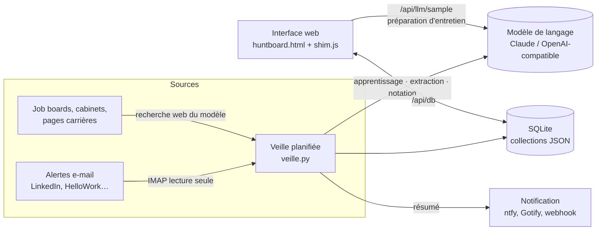

# Architecture

## Composants

| Composant | Fichier | Rôle |
|---|---|---|
| Interface | `kit/skills/huntboard/template/huntboard.html` | Page unique bilingue : Offres, Suivi (kanban), Tableau de bord, Coach, Paramètres (CV, critères, sources, apprentissage, données), fiche d'offre, préparation et rédaction, assistant de démarrage |
| Adaptateur | `app/frontend/shim.js` | Fournit `window.claude.use("db" \| "sample")` au-dessus de l'API, pour réutiliser la page de l'artifact |
| API | `app/backend/huntboard/main.py` | Documents (`/api/db`), modèle (`/api/llm/sample`), veille (`/api/veille/*`), authentification simple |
| Stockage | `app/backend/huntboard/store.py` | Collections de documents JSON versionnés dans SQLite |
| Modèle | `app/backend/huntboard/llm.py` | Fournisseurs `anthropic` et `openai` (compatible), trois niveaux de modèle, JSON tolérant, recherche web |
| Veille | `app/backend/huntboard/veille.py` | Apprentissage, lecture des alertes, recherche web, dédoublonnage, notation, écriture, notification |

## Déroulé d'un passage de veille

1. **Apprentissage** : les offres écartées ou retenues (avec motifs) produisent au plus
   8 tendances, chacune justifiée et plafonnée à ±10 points.
2. **Alertes e-mail** : lecture IMAP des expéditeurs configurés (`ALERT_SENDERS`) ;
   parseur déterministe pour LinkedIn, extraction par le modèle pour les autres.
3. **Web** : avec Claude, recherche guidée par la liste de sources et leurs consignes ;
   avec un autre fournisseur, téléchargement des pages listées et extraction.
4. **Dédoublonnage** par identifiant LinkedIn ou couple entreprise/intitulé.
5. **Notation** par lots de 15 avec les critères explicites et les tendances.
6. **Écriture** des 25 meilleures offres et 5 recherches d'associés au plus, puis résumé
   et notification.

## Équivalence avec le kit Claude

| Kit Claude | Application |
|---|---|
| Base de l'artifact | SQLite (`/data/huntboard.sqlite3`) |
| `window.claude.use("sample")` | `/api/llm/sample` avec votre clé d'API |
| Tâche programmée | APScheduler (`VEILLE_CRON`) |
| Connecteur Gmail | IMAP (`IMAP_*`) |
| Notification de l'application Claude | `NOTIFY_URL` (ntfy, Gotify…) |
