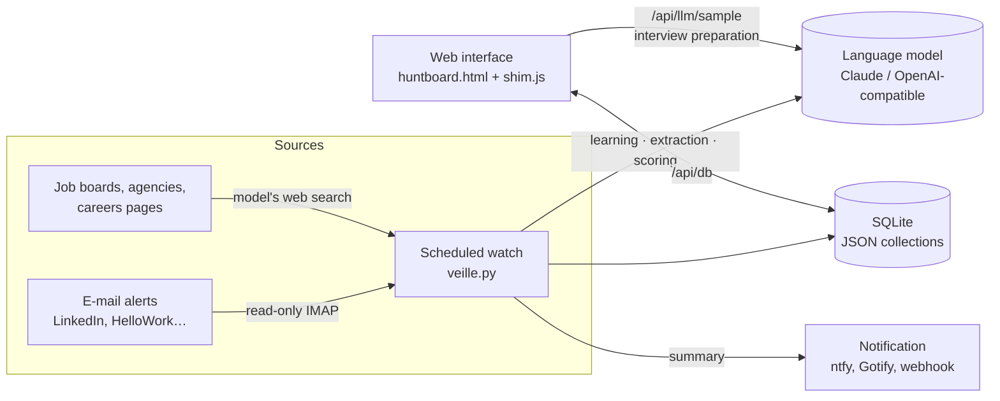

# Architecture

*Version française : [architecture.md](../fr/architecture.md)*

## Components

| Component | File | Role |
|---|---|---|
| Interface | `kit/skills/huntboard/template/huntboard.html` | Single bilingual page: Offers, Pipeline (kanban), Board, Assistant and notes, Settings (profile and CV, documents, search, learning and data), offer page, preparation and writing, setup assistant, guide |
| Adapter | `app/frontend/shim.js` | Provides `window.claude.use("db" \| "sample" \| "downloads" \| "assets")` on top of the API, to reuse the artifact page, and the app-only functions (`window.huntboardApp`) |
| API | `app/backend/huntboard/main.py` | Documents (`/api/db`), model (`/api/llm/sample`), watch (`/api/veille/*`), simple authentication |
| Storage | `app/backend/huntboard/store.py` | Collections of versioned JSON documents in SQLite |
| Model | `app/backend/huntboard/llm.py` | `anthropic` and `openai` (compatible) providers, three model tiers, tolerant JSON, web search built into the provider or through an external service (Brave, Tavily, SearXNG) — see [ai-engines.md](ai-engines.md) |
| Watch | `app/backend/huntboard/veille.py` | Learning, alert reading, web search, de-duplication, scoring, writing, notification |

## What a watch run does

1. **Learning**: discarded or kept offers (with reasons) produce at most 8 trends, each
   justified and capped at ±10 points.
2. **E-mail alerts**: IMAP reading of the configured senders (`ALERT_SENDERS`); deterministic
   parser for LinkedIn, extraction by the model for the others.
3. **Web**: search guided by the list of sources and their instructions, with the provider's
   built-in search or an external service (Brave, Tavily, SearXNG); without web search, the
   listed pages are downloaded and offers extracted.
4. **Acknowledgements**: application confirmation e-mails, whatever the sender, move the offer
   to "Applied" or create it; offers to score (manual additions, direct applications) are
   scored.
5. **De-duplication** by LinkedIn id or company/title pair.
6. **Scoring** in batches of 15 with the explicit criteria and the trends.
7. **Writing** of at most the 25 best offers and 5 co-founder searches, extra tracks, e-mail
   follow-up, text of the postings being explored, then (on Mondays) one or two suggested
   sources, summary and notification.

## Equivalence with the Claude kit

| Claude kit | App |
|---|---|
| Artifact database | SQLite (`/data/huntboard.sqlite3`) |
| `window.claude.use("sample")` | `/api/llm/sample` with your API key |
| Scheduled task | APScheduler (`VEILLE_CRON`) |
| Gmail connector | IMAP (`IMAP_*`) |
| Claude app notification | `NOTIFY_URL` (ntfy, Gotify…) |
