# Tutorial — getting started with Huntboard

*Version française : [tutoriel.md](../fr/tutoriel.md)*

This tutorial follows a first use, from installation to the daily routine. Allow about fifteen
minutes for the setup, then five to ten minutes a day.

All screenshots use fictional data (`scripts/demo_data.py`).

**Prerequisite: an AI connection** (a Claude account for the kit, an API key or a local model
for the self-hosted app). See the [README](../../README.md#️-prerequisite-an-ai-connection).

---

## 1. Install

**Claude kit** — download `huntboard-skill.zip` from the repository's *Releases* page, add it
as a skill in Claude, then write in a conversation: "Set up my Huntboard". Claude publishes
your page, prepares the map and schedules the morning watch.

**Self-hosted app** — on a server with Docker:

```bash
mkdir huntboard && cd huntboard
curl -fsSLO https://raw.githubusercontent.com/tamaris-labs/huntboard/main/deploy/docker-compose.yml
curl -fsSL -o .env https://raw.githubusercontent.com/tamaris-labs/huntboard/main/.env.example
nano .env                   # at least LLM_API_KEY and APP_PASSWORD
docker compose up -d
```

Open `http://<server>:8000`. Details: [deployment.md](deployment.md); other AI engines:
[ai-engines.md](ai-engines.md).

## The built-in guide

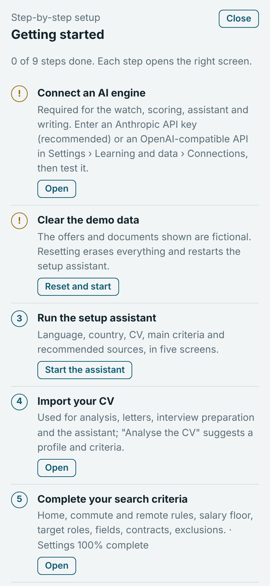

The **Guide** button, at the top of the screen, opens the list of setup steps at any time with
their state (done, to do, to fix); each step opens the right screen directly. The guide also
opens automatically at the end of the setup assistant.

- **Demo data** (Codespace, trials): a banner says so; *Reset and start* erases everything and
  restarts the assistant. Reset is also available in Settings › Learning and data › Reset
  (confirmed by typing the word ERASE).
- **AI engine** (self-hosted app): Settings › Learning and data › **Connections**: provider
  (with address presets), API key, address (OpenAI-compatible API) and models, with a *Test*
  button, then web search. These settings take precedence over the `.env` file and are never
  shown again. The same section sets up the mailbox (read-only IMAP) and the notification
  address. In the Claude kit, your account's AI is used: nothing to configure.

<br clear="right">

## 2. Follow the setup assistant

<p>
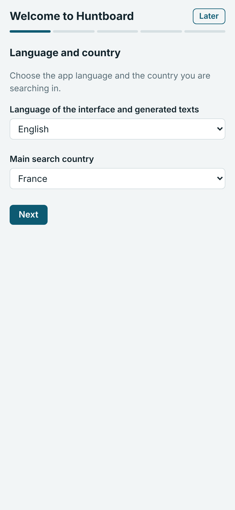
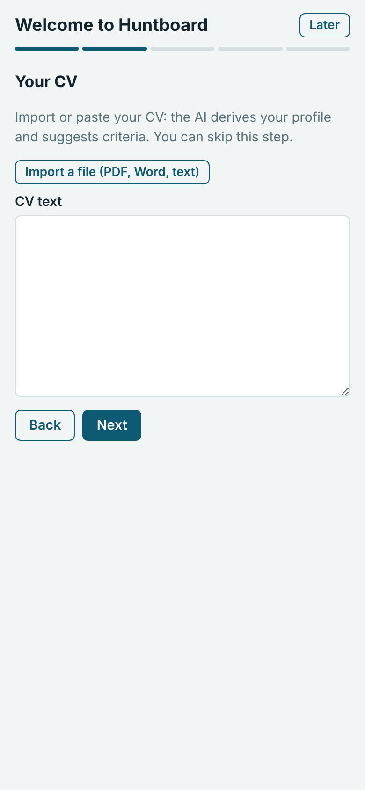
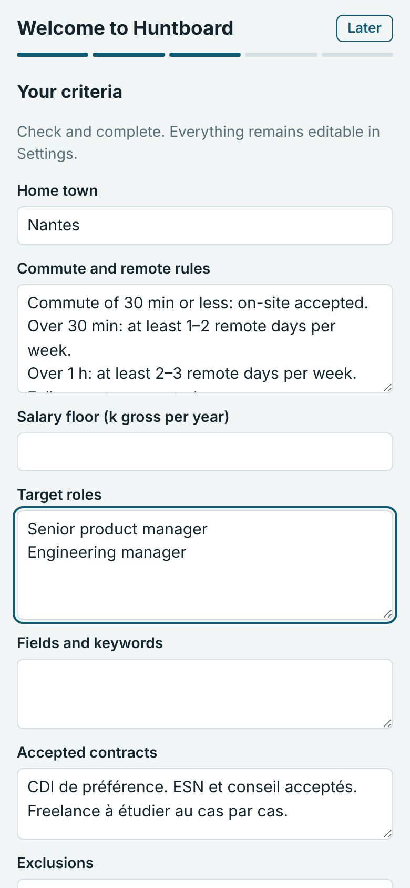
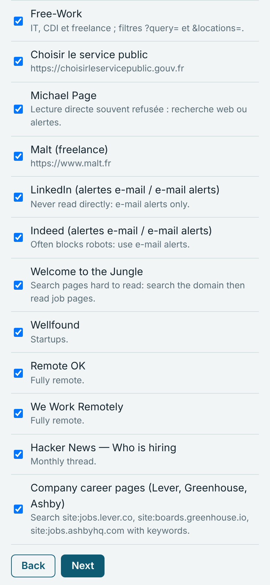
</p>

1. **Language and country**: the language of the interface and of generated texts, the country
   you search in.
2. **CV**: import a PDF, a Word file or paste the text. The AI analyses it and proposes a
   profile and criteria. If the import button does not respond on a phone, send the file in
   the Claude conversation.
3. **Criteria**: home, commute and remote-work rules, salary floor, target roles (one per
   line), fields, contracts, exclusions. Everything can be changed later.
4. **Sources**: the recommended sources for your country, to tick or untick.
5. **Finish**: the first watch can be run right away.

## 3. Complete the setup


In **Settings**, the gauge shows how complete the setup is and what is missing; tapping an item
opens the right field.

- **Review with AI** checks consistency: roles and seniority, pay and region, suitable sources.
- **Home address** (Search › Criteria): private, it is used for the map and commute times.
  *Place on the map* lets you position it precisely.
- **Sources** (Search › Sources): *Suggest sources with AI* proposes sources suited to your
  profile and flags those that bring nothing; *Check and extend on the web* tests the
  addresses. Tick, then *Add selection*. Every Monday, the watch proposes one or two more.
  Details: [settings.md](settings.md#source-suggestions).
- **E-mail alerts**: create precise alerts (title and area) on LinkedIn, Indeed or HelloWork;
  the watch reads them in your mailbox, without ever signing in to your accounts.

<br clear="right">

## 4. Add separate tracks (optional)

<p>
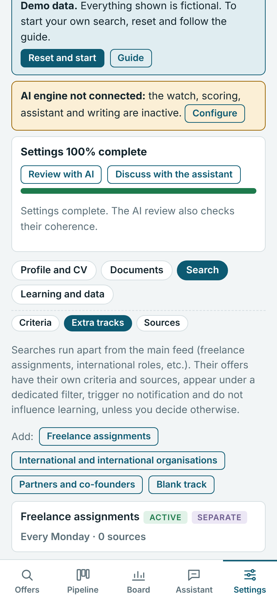
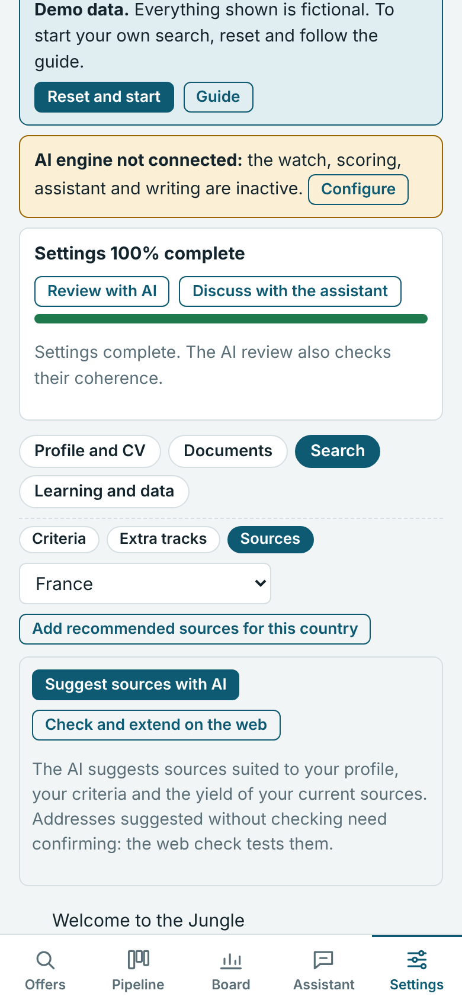
</p>

Search › **Extra tracks**: freelance assignments, international roles, co-founder search or a
custom track. Each track has its own criteria (including a day rate for freelance), sources and
frequency. By default, its offers stay in a separate filter, with no notification and no effect
on learning. *Fill with AI* completes the track from your CV.

## 5. Triage the morning offers

<p>

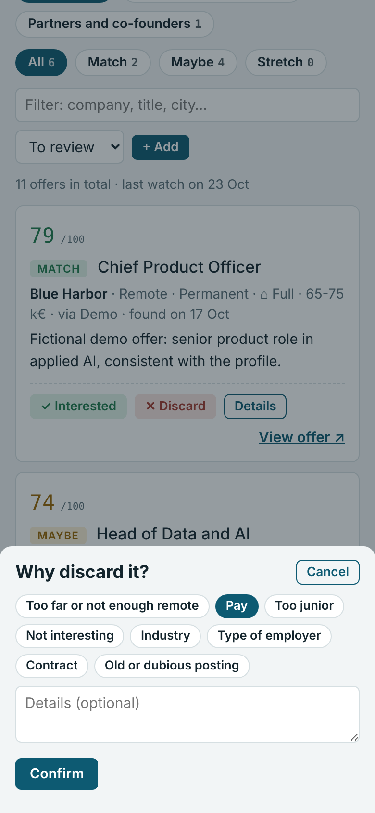
</p>

Every morning, a notification announces what is new. In **Offers**:

- the *Match*, *Maybe* and *Stretch* filters sort the offers;
- **Interested** sends them to the pipeline; **Discard** asks for a one-tap reason (commute,
  pay, sector…). These reasons train the scoring of the following days;
- **+ Add** saves an offer found elsewhere (link or text): it will be scored at the next watch.

## 6. Follow an offer

<p>
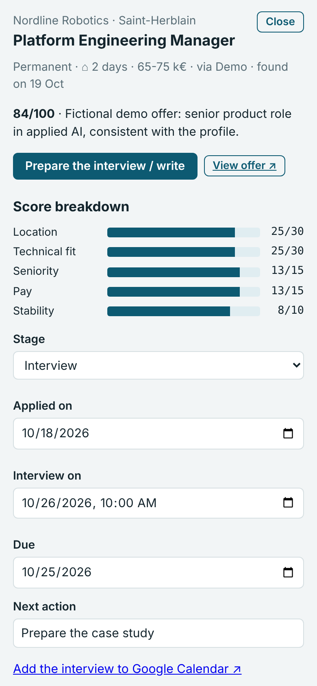

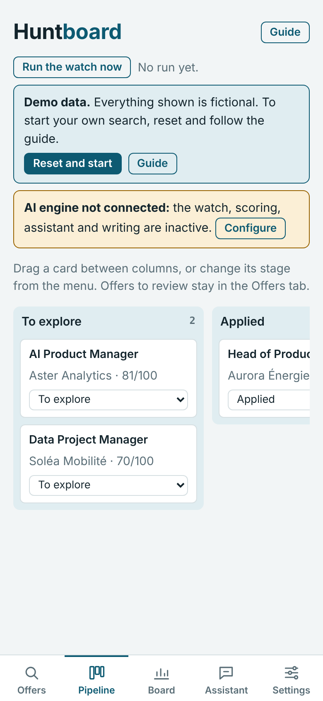
</p>

The offer page gathers the score breakdown, the stage, the dates (application, interview, due
date), the next action, notes and history. Add the **contacts** there (clickable e-mail and
phone). The **full posting text** is kept as soon as the offer is marked "To explore", even if
the posting disappears.

When you apply, the **acknowledgement** received by e-mail (job board, Workday,
SmartRecruiters…) is picked up by the next watch: the offer moves to "Applied", or is created
then scored if it was not yet in Huntboard.

The **Pipeline** tab shows the applications in columns; drag a card or change its stage in the
menu.

## 7. Prepare interviews and write

<p>
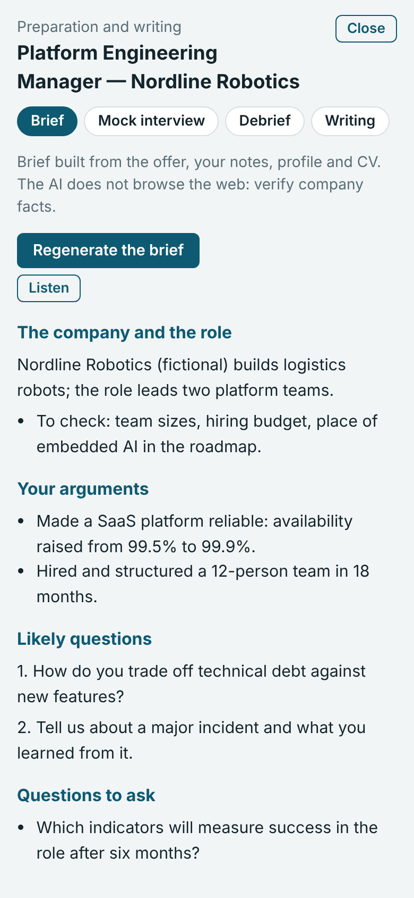
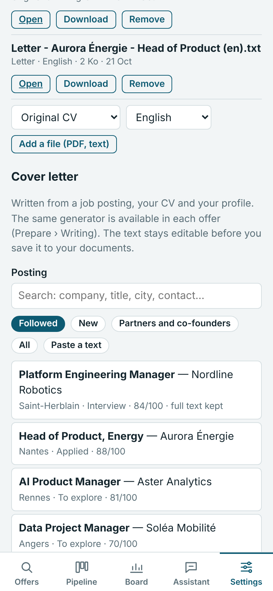
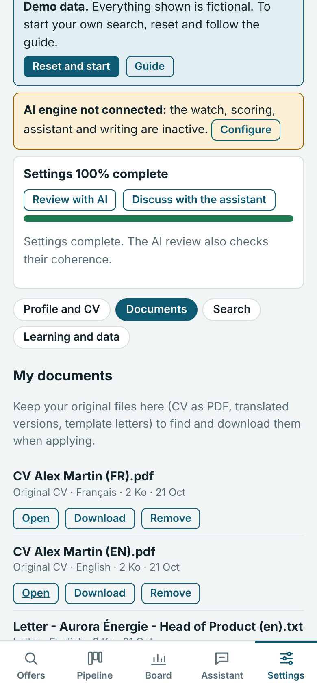
</p>

- **Prepare** (from the offer page): interview brief, scored mock interview, debrief after the
  interview, writing (letter, follow-up, thank-you, LinkedIn message). *Listen* reads the brief
  aloud.
- **Documents**: keep your original and translated CVs, and your letters. The letter generator
  lets you find the offer by keyword or filter, and takes inspiration from your saved letters.

## 8. Work with the assistant

<p>

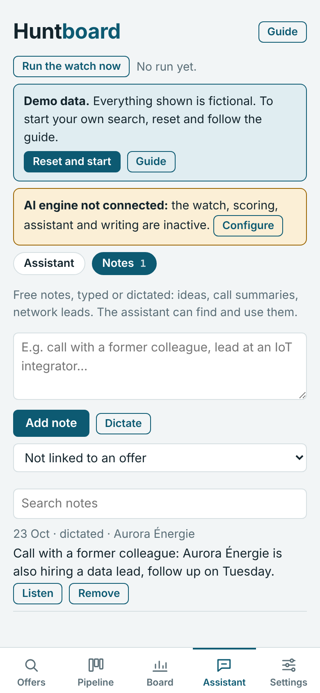
</p>

In **Assistant**, ask your questions in plain language: "Where do I stand this week?", "Which
applications have had no news for ten days?", "Move the Nordline offer to interview on Thursday
10am". The assistant looks up your data and **proposes** the changes: nothing is applied until
you validate, with a tap or by answering "yes" or "no", in writing or by voice.

The **Notes** tab collects your free notes, typed or dictated (call summary, networking lead);
the assistant can find them.

## 9. Keep the pace

<p>
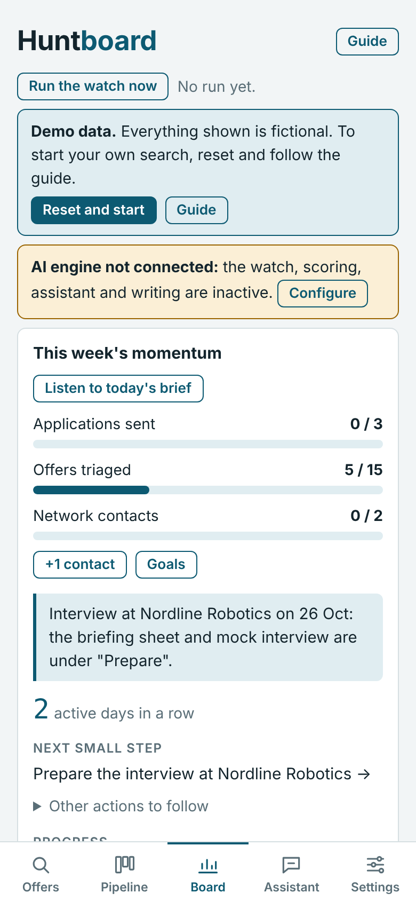
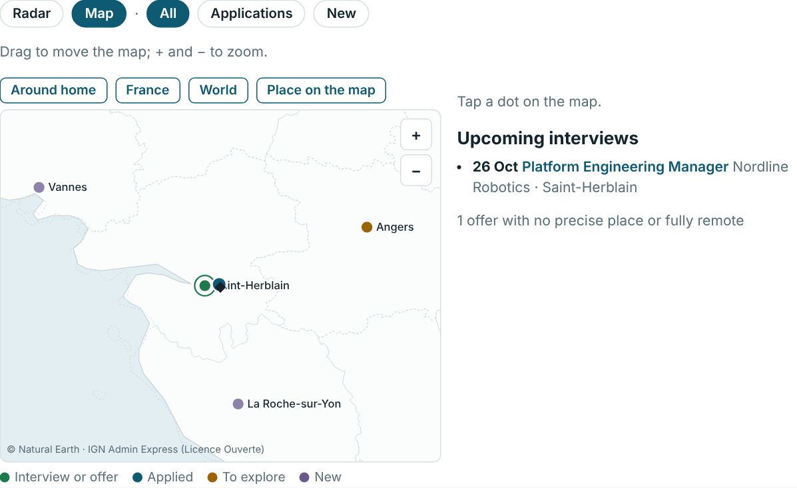
</p>

The **Board** opens on **this week's momentum**: goals (applications, offers triaged, network
contacts), streak of active days, next small step and progress log. *Listen to today's brief*
gives a spoken summary. The **map** shows offers and interviews around your home.

## 10. Let the tool learn

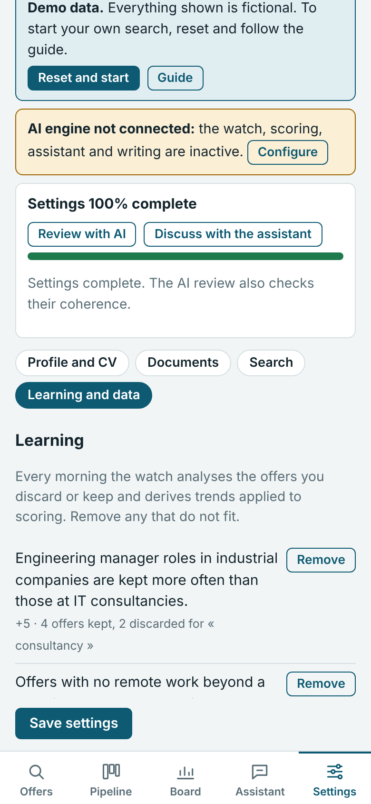

After a dozen triage decisions, **Learning and data** shows the trends deduced from your
choices, with their effect on the score and their justification. Remove those that do not fit
you: they will not come back. Explicit criteria always take precedence.

The same section offers export and import of all your data (JSON).

<br clear="right">

---

## Suggested routine

| When | What | Time |
|---|---|---|
| Every morning | Read the notification, triage the new offers | 5 min |
| Two to three times a week | Apply to the selected offers with the letter generator | 30 min |
| Every week | Review with the assistant, follow up, adjust the goals | 15 min |
| Before an interview | Brief, mock interview, then debrief | 45 min |

Questions and known limits: [limitations.md](limitations.md). Full settings reference:
[settings.md](settings.md).
