# Tutoriel — prise en main de Huntboard

Ce tutoriel suit une première utilisation, de l'installation à la routine quotidienne. Comptez
une quinzaine de minutes pour le paramétrage, puis cinq à dix minutes par jour.

Toutes les captures utilisent des données fictives (`scripts/demo_data.py`).

**Prérequis : une connexion à une IA** (compte Claude pour le kit, clé d'API pour l'application
autonome). Voir le [README](../README.md#️-prerequisite-an-ai-connection).

---

## 1. Installer

**Kit Claude** — téléchargez `huntboard-skill.zip` depuis la page *Releases* du dépôt, ajoutez-le
comme skill dans Claude, puis écrivez dans une conversation : « Installe mon Huntboard ». Claude
publie votre page, prépare la carte et planifie la veille du matin.

**Application autonome** — sur un serveur avec Docker :

```bash
mkdir huntboard && cd huntboard
curl -fsSLO https://raw.githubusercontent.com/tamaris-labs/huntboard/main/deploy/docker-compose.yml
curl -fsSL -o .env https://raw.githubusercontent.com/tamaris-labs/huntboard/main/.env.example
nano .env                   # LLM_API_KEY et APP_PASSWORD au minimum
docker compose up -d
```

Ouvrez `http://<serveur>:8000`. Détails : [deploiement.md](deploiement.md).

## Le guide intégré

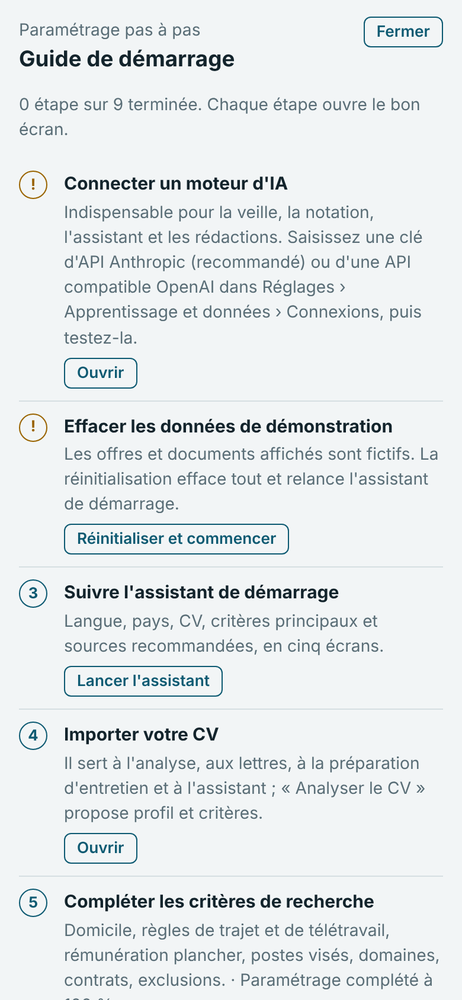

Le bouton **Guide**, en haut de l'écran, ouvre à tout moment la liste des étapes de paramétrage
avec leur état (faite, à faire, à corriger) ; chaque étape ouvre directement le bon écran. Le
guide s'affiche aussi automatiquement à la fin de l'assistant de démarrage.

- **Données de démonstration** (Codespace, essais) : un bandeau le signale ; *Réinitialiser et
  commencer* efface tout et relance l'assistant. La réinitialisation est aussi disponible dans
  Réglages › Apprentissage et données › Réinitialiser (confirmation par le mot EFFACER).
- **Moteur d'IA** (application autonome) : Réglages › Apprentissage et données › **Connexions** :
  fournisseur, clé d'API, adresse (API compatible OpenAI) et modèles, avec un bouton *Tester*.
  Ces réglages priment sur le fichier `.env` et ne sont jamais réaffichés. La même section règle
  la messagerie (IMAP en lecture seule) et l'adresse de notification. Dans le kit Claude, l'IA
  de votre compte est utilisée : rien à configurer.

<br clear="right">

## 2. Suivre l'assistant de démarrage

<p>
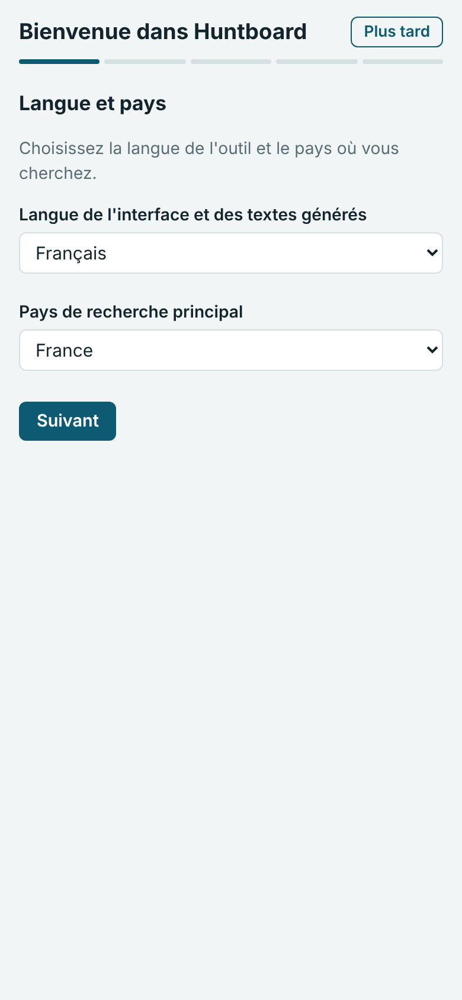
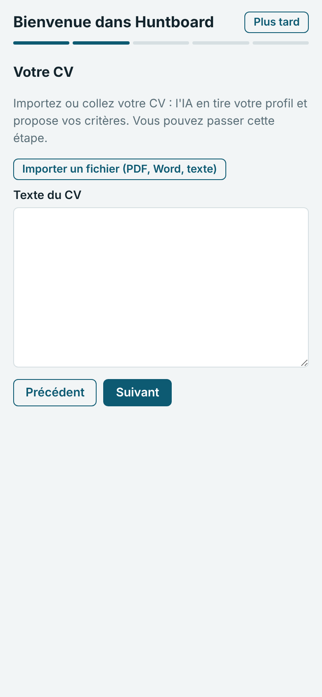
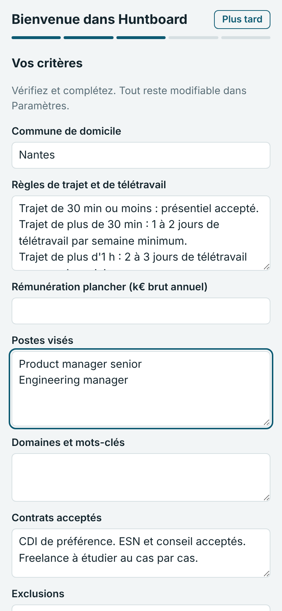
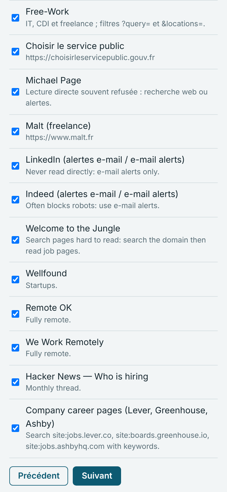
</p>

1. **Langue et pays** : la langue de l'interface et des textes produits, le pays de recherche.
2. **CV** : importez un PDF, un fichier Word ou collez le texte. L'IA l'analyse et propose un
   profil et des critères. Si le bouton d'import ne réagit pas sur téléphone, envoyez le
   fichier dans la conversation Claude.
3. **Critères** : domicile, règles de trajet et de télétravail, rémunération plancher, postes
   visés (un par ligne), domaines, contrats, exclusions. Tout reste modifiable ensuite.
4. **Sources** : les sources recommandées pour votre pays, à cocher ou décocher.
5. **Terminer** : la première veille peut être lancée tout de suite.

## 3. Compléter le paramétrage

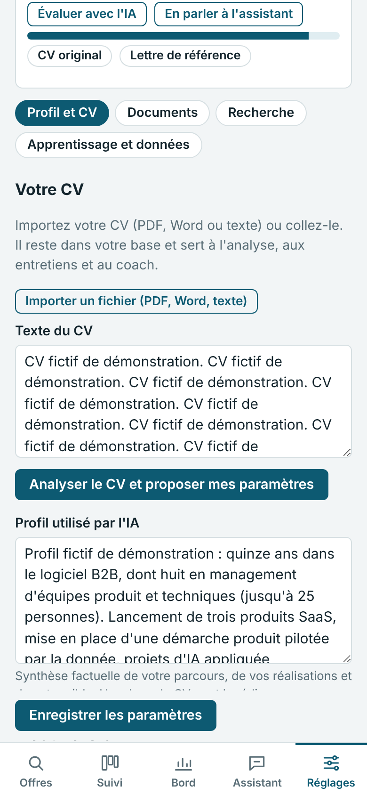

Dans **Réglages**, la jauge indique le taux de complétude et les éléments manquants ; un appui
sur un élément ouvre le bon champ.

- **Évaluer avec l'IA** vérifie la cohérence : postes et séniorité, rémunération et région,
  sources adaptées.
- **Adresse du domicile** (Recherche › Critères) : privée, elle sert à la carte et aux temps de
  trajet. *Placer sur la carte* permet de la positionner précisément.
- **Sources** (Recherche › Sources) : *Suggérer des sources avec l'IA* propose des sources
  adaptées à votre profil et signale celles qui ne rapportent rien ; *Vérifier et compléter sur
  le web* teste les adresses. Cochez, puis *Ajouter la sélection*. Chaque lundi, la veille en
  propose une ou deux autres. Détails : [parametrage.md](parametrage.md#suggestions-de-sources).
- **Alertes e-mail** : créez sur LinkedIn, Indeed ou HelloWork des alertes précises (intitulé et
  zone) ; la veille les lit dans votre messagerie, sans jamais se connecter à vos comptes.

<br clear="right">

## 4. Ajouter des pistes séparées (facultatif)

<p>
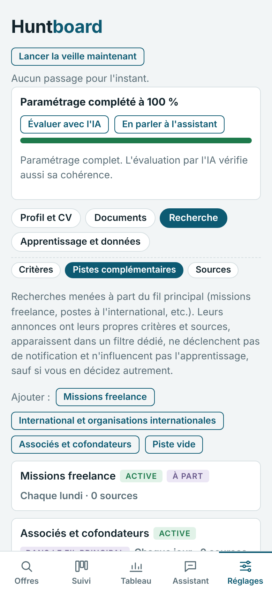
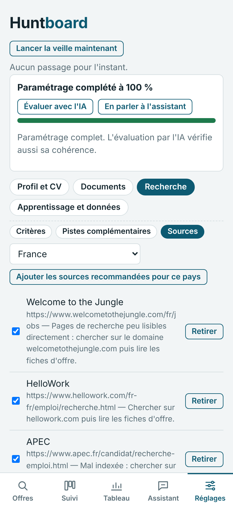
</p>

Recherche › **Pistes complémentaires** : missions freelance, postes à l'international,
recherche d'associés ou piste libre. Chaque piste a ses critères (dont un TJM pour le
freelance), ses sources et sa fréquence. Par défaut, ses annonces restent dans un filtre
séparé, sans notification ni effet sur l'apprentissage. *Compléter avec l'IA* remplit la piste à
partir de votre CV.

## 5. Trier les offres du matin

<p>
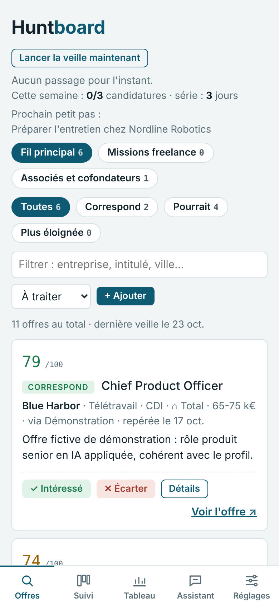
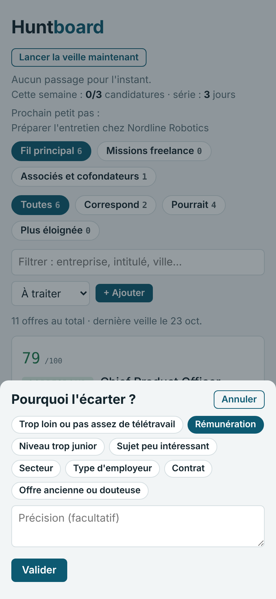
</p>

Chaque matin, une notification annonce les nouveautés. Dans **Offres** :

- les filtres *Correspond*, *Pourrait correspondre* et *Plus éloignée* classent les offres ;
- **Intéressé** les envoie dans le suivi ; **Écarter** demande un motif en un geste (trajet,
  rémunération, secteur…). Ces motifs entraînent la notation des jours suivants ;
- **+ Ajouter** enregistre une offre trouvée ailleurs (lien ou texte) : elle sera notée à la
  prochaine veille.

## 6. Suivre une offre

<p>
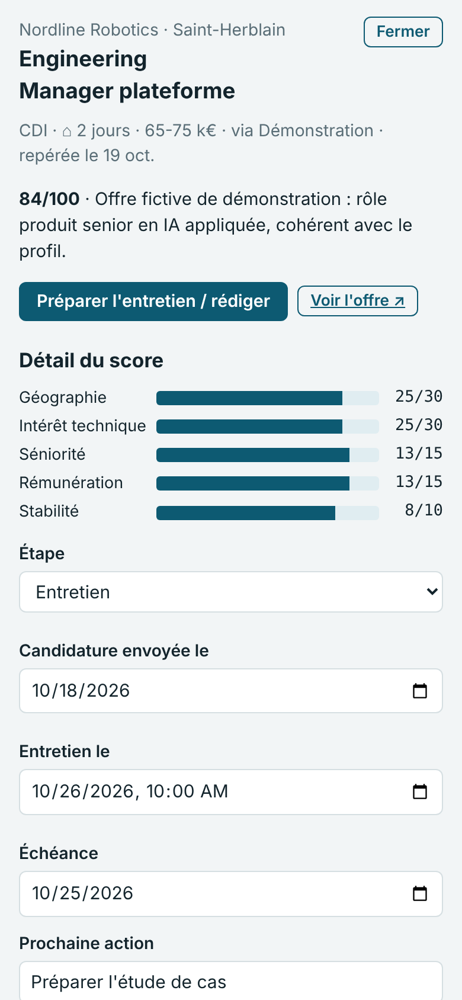
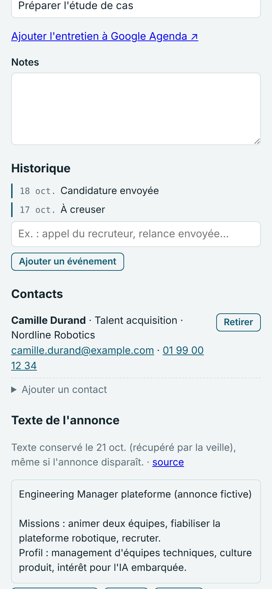
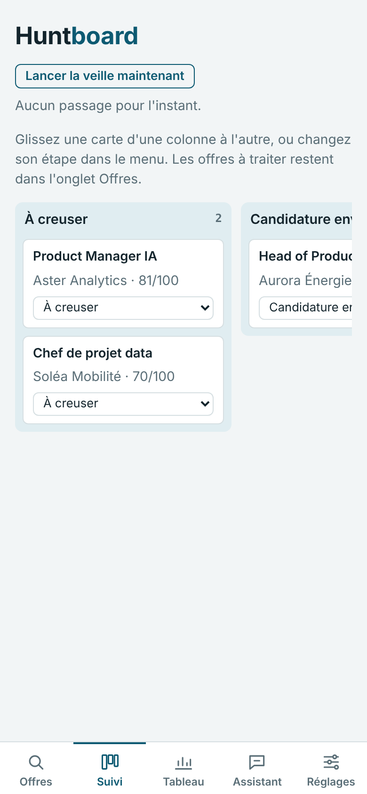
</p>

La fiche d'offre réunit le détail du score, l'étape, les dates (candidature, entretien,
échéance), la prochaine action, les notes et l'historique. Ajoutez-y les **contacts** (e-mail et
téléphone cliquables). Le **texte intégral de l'annonce** est conservé dès que l'offre passe
« À creuser », même si l'annonce disparaît.

L'onglet **Suivi** présente les candidatures en colonnes ; glissez une carte ou changez son étape
dans le menu.

## 7. Préparer les entretiens et rédiger

<p>
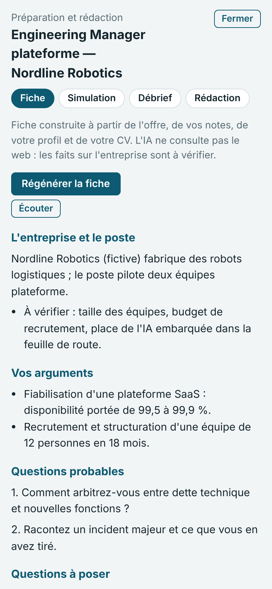
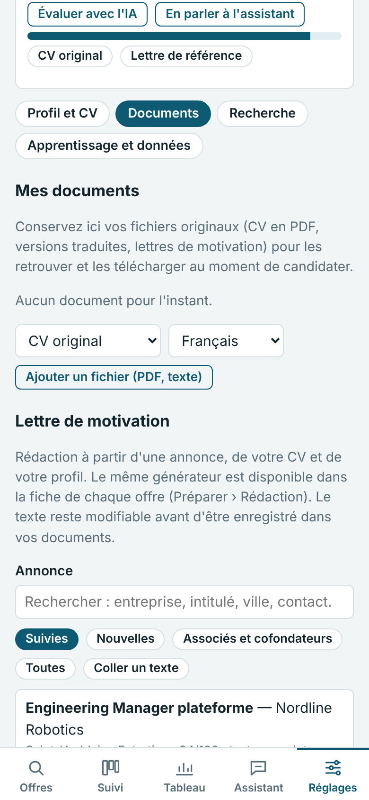
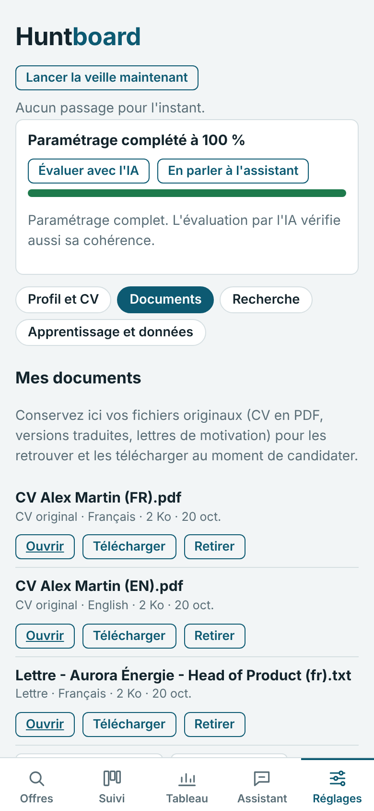
</p>

- **Préparer** (depuis la fiche) : fiche d'entretien, simulation notée, débrief après
  l'entretien, rédaction (lettre, relance, remerciement, message LinkedIn). *Écouter* lit la
  fiche à voix haute.
- **Documents** : conservez vos CV originaux et traduits, et vos lettres. Le générateur de lettre
  permet de chercher l'offre par mot-clé ou par filtre, et s'inspire de vos lettres
  enregistrées.

## 8. Travailler avec l'assistant

<p>
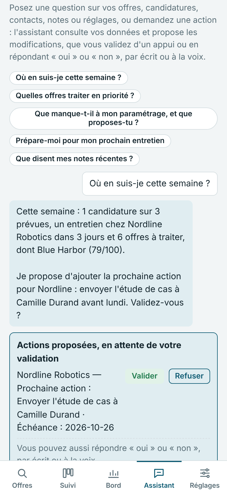
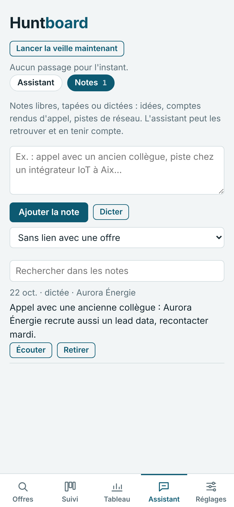
</p>

Dans **Assistant**, posez vos questions en langage courant : « Où en suis-je cette semaine ? »,
« Quelles candidatures sont sans nouvelles depuis dix jours ? », « Passe l'offre Nordline en
entretien jeudi 10 h ». L'assistant consulte vos données et **propose** les modifications :
rien n'est appliqué tant que vous n'avez pas validé, d'un appui ou en répondant « oui » ou
« non », par écrit ou à la voix.

L'onglet **Notes** recueille vos notes libres, tapées ou dictées (compte rendu d'appel, piste de
réseau) ; l'assistant sait les retrouver.

## 9. Garder le rythme

<p>
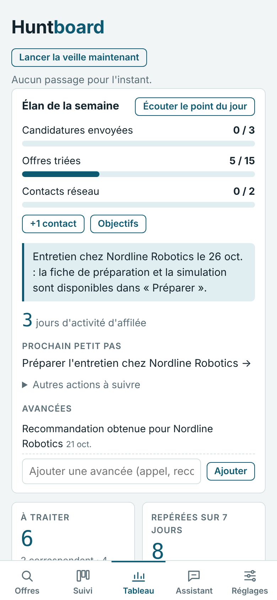
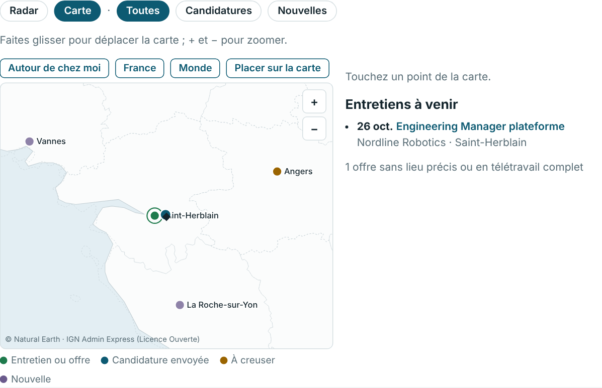
</p>

Le **Tableau** de bord ouvre sur l'**élan de la semaine** : objectifs (candidatures, offres
triées, contacts réseau), série de jours actifs, prochain petit pas et journal des avancées.
*Écouter le point du jour* en donne un résumé à voix haute. La **carte** situe offres et
entretiens autour de votre domicile.

## 10. Laisser l'outil apprendre

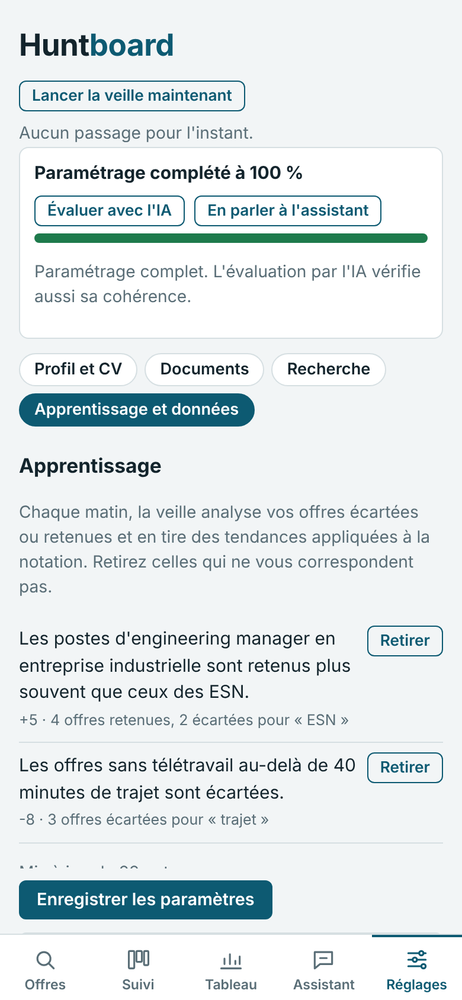

Après une dizaine de tris, **Apprentissage et données** affiche les tendances déduites de vos
choix, avec leur effet sur la note et leur justification. Retirez celles qui ne vous
correspondent pas : elles ne reviendront pas. Les critères explicites priment toujours.

La même section propose l'export et l'import de toutes vos données (JSON).

<br clear="right">

---

## Routine conseillée

| Quand | Quoi | Durée |
|---|---|---|
| Chaque matin | Lire la notification, trier les nouvelles offres | 5 min |
| Deux à trois fois par semaine | Postuler aux offres retenues avec le générateur de lettre | 30 min |
| Chaque semaine | Faire le point avec l'assistant, relancer, ajuster les objectifs | 15 min |
| Avant un entretien | Fiche, simulation, puis débrief | 45 min |

Questions et limites connues : [limitations.md](limitations.md). Référence complète des réglages :
[parametrage.md](parametrage.md).
